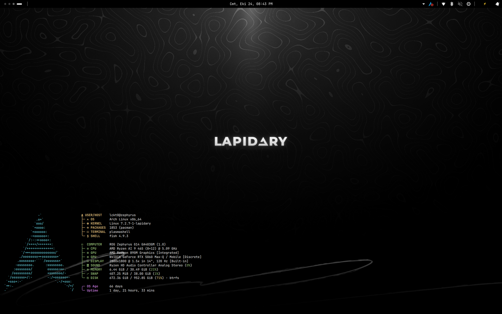

# iris-desktop

**English** · [Türkçe](README.tr.md)

A pitch-black desktop theme for KDE Plasma 6: pure `#000000` ground, mostly
black and white, thin grey borders and a 2px radius everywhere. Colour is used
only where it means something (errors, warnings, success, low battery).



> **A note before you start:** iris-desktop was originally built for my own setup and daily use, and later shared in case it helps someone else. It reflects my own hardware, tools and preferences, so it may not fit every system or workflow. Issues and suggestions are welcome, but please keep that in mind.

The screenshot shows the Iris layout: a single 30px panel at the top with the
virtual desktop pager and tasks on the left, the clock in the centre, and on
the right the application tray, network, Bluetooth, volume, battery, power
draw and notifications. Icons are Papirus. The wallpaper in the screenshot is
a personal one; the bundled Iris Topo wallpaper looks like this:


All design values live in one place: [`docs/TOKENS.md`](docs/TOKENS.md).

## Contents

| Part | Path | What it does |
|---|---|---|
| Colour scheme | `colors/iris.colors` | System-wide palette: pure black window and view backgrounds, grey selection, white focus ring, grey inactive title bars. |
| Plasma style | `desktoptheme/iris/` | Panel, popup, tooltip, button and list SVGs (9-slice, 2px radius). Generated by `scripts/gen_desktoptheme.py`. |
| Window decoration | `decoration/klassyrc` | [Klassy](https://github.com/paulmcauley/klassy) configuration: 2px corners, grey window outline, Fluent-style buttons. |
| Wallpaper | `wallpaper/org.lckt0.iris.topo/` | 2880x1800 topographic contours, almost entirely pure black. Generated by `scripts/gen_wallpaper.py`. |
| Look-and-feel | `look-and-feel/org.lckt0.iris/` | Global theme that ties it together: colours, Plasma style, Klassy, Papirus icons, wallpaper, a black splash screen and the panel layout. |
| Rofi theme | `rofi/iris.rasi` | Same palette for rofi. |
| KWin script | `kwinscript/iris-popup-anchor/` | Pins panel applet popups to the top-right corner, directly below the panel. |

Panel widgets:

| Widget | Id | |
|---|---|---|
| Iris Tasks | `io.github.lckt0.iristasks` | Minimal task manager: icon and title, a sliding active indicator, buttons that shrink as space runs out. |
| Iris Digital Clock | `io.github.lckt0.irisclock` | Fork of Plasma's digital clock (plasma-workspace 6.7.5) that always prints AM/PM in Latin script. |
| Iris Power & Battery | `io.github.lckt0.irisbattery` | Fork of Plasma's battery widget (powerdevil 6.7.5) with the percentage beside the icon. |
| Iris Power | `io.github.lckt0.irispower` | Battery power draw averaged over the last minute. |
| Iris Fetch | `io.github.lckt0.irisfetch` | Desktop widget: fastfetch output drawn natively, keys and values in aligned columns. |

The forks install under their own ids, so the stock widgets keep working.
Their changes against upstream are in [`patches/`](patches).

The panel layout also uses these widgets from other projects. None of them is
strictly required: the layout falls back to the stock Plasma widget when one
is missing.

| Widget | Id | Source | Fallback |
|---|---|---|---|
| Mike Desktop | `com.mike.desktop` | KDE Store (Get New Widgets → "Mike Desktop") | Pager |
| Advanced Separator | `luisbocanegra.advanced_separator` | [plasma-advanced-separator](https://github.com/luisbocanegra/plasma-advanced-separator) | Margins Separator |
| Audio Volume (Multi-Output) | `io.github.lckt0.volume` | [iris-volume](https://github.com/lckt0/iris-volume) | Audio Volume |

Network, Bluetooth and notifications are Plasma's own widgets, placed directly
in the panel instead of inside the system tray.

Motion: the global animation factor is set to 0.5, transitions are 90–150 ms
and only animate opacity, scale and position. Nothing spins or pulses.

## Installation

### Requirements

- KDE Plasma 6 (Wayland or X11)
- [Klassy](https://github.com/paulmcauley/klassy) for the window decoration and application style
- [Papirus](https://github.com/PapirusDevelopmentTeam/papirus-icon-theme) icon theme
- JetBrains Mono font
- Optional: fastfetch (for Iris Fetch), rofi, and the third-party widgets
  listed above

On Arch Linux:

```sh
sudo pacman -S --needed papirus-icon-theme ttf-jetbrains-mono ttf-jetbrains-mono-nerd fastfetch rofi
yay -S klassy          # from the AUR, or use any AUR helper
```

Mike Desktop and Advanced Separator can be installed from **right-click on a
panel → Add or Manage Widgets → Get New Widgets → Download New Plasma
Widgets**. For Audio Volume (Multi-Output), see the
[iris-volume](https://github.com/lckt0/iris-volume) README.

There is no Arch package for the theme itself; use the install script.

### Install script

```sh
git clone https://github.com/lckt0/iris-desktop.git
cd iris-desktop
bash install.sh
```

Options:

```sh
bash install.sh --no-apply   # only copy the files, change no settings
bash install.sh --layout     # also replace your panels with the Iris layout
```

A full install copies these files:

| Source | Destination |
|---|---|
| `colors/iris.colors` | `~/.local/share/color-schemes/Iris.colors` |
| `desktoptheme/iris/` | `~/.local/share/plasma/desktoptheme/iris/` |
| `wallpaper/org.lckt0.iris.topo/` | `~/.local/share/wallpapers/org.lckt0.iris.topo/` |
| `look-and-feel/org.lckt0.iris/` | `~/.local/share/plasma/look-and-feel/org.lckt0.iris/` |
| `applets/io.github.lckt0.*` | `~/.local/share/plasma/plasmoids/` |
| `decoration/klassyrc` | `~/.config/klassy/klassyrc` (replaces an existing file) |
| `rofi/iris.rasi` | `~/.config/rofi/themes/iris.rasi` |

and, unless `--no-apply` is given, then:

- applies the Iris colour scheme, Plasma style and wallpaper, and selects
  Papirus as the icon theme if it is installed;
- sets Klassy as window decoration and application style, the animation
  factor to 0.5, and enables the blur, contrast, fade and scale effects
  (wobbly windows and magic lamp off) in `kwinrc`;
- adds an "Iris title bar" window rule to `kwinrulesrc` so that inactive title
  bars get the scheme's grey (`#1C1C1C`) with unchanged text (Plasma drops
  those colours when it copies the scheme into `kdeglobals`);
- removes Breeze colour scheme overrides from `dolphinrc`, `kdenliverc`,
  `konsolerc`, `katerc` and `okularrc`;
- enables GTK animations and selects the rofi theme if `~/.config/rofi/config.rasi` exists.

With `--layout` it also applies the Iris global theme with its desktop layout
(`plasma-apply-lookandfeel --apply org.lckt0.iris --resetLayout`). This
**removes your current panels and desktop widgets** and creates the Iris
panel and the Iris Fetch desktop widget.

Window decoration changes, and new versions of widgets that are already on a
panel, take effect at the next login.

### Manual installation

Copy the files from the table above to their destinations, then select:

- **System Settings → Colors & Themes → Global Theme → Iris**. Tick
  "Desktop and window layout" in the apply dialog if you want the Iris panel
  layout as well. Or pick the parts individually: **Colors → Iris**,
  **Plasma Style → Iris**, **Window Decorations → Klassy**,
  **Application Style → Klassy**, **Icons → Papirus**;
- the wallpaper: right-click the desktop → **Configure Desktop and Wallpaper** → **Iris Topo**.

### Widgets and the KWin script

Without the Iris layout, add the widgets with right-click on a panel →
**Add or Manage Widgets** and search for "Iris". Iris Fetch goes on the
desktop (right-click the desktop → **Add or Manage Widgets**).

The KWin script is not installed by `install.sh`:

```sh
kpackagetool6 --type KWin/Script --install kwinscript/iris-popup-anchor
```

Then enable **Iris Popup Anchor** in **System Settings → Window Management → KWin Scripts**.

## Uninstallation

1. Switch back to the default theme:

   ```sh
   plasma-apply-lookandfeel -a org.kde.breezedark.desktop
   ```

   This restores the Breeze Dark colours, Plasma style, icons, window
   decoration and application style. Alternatively pick **Breeze Dark** (or
   **Breeze**) in **System Settings → Colors & Themes → Global Theme**, and
   reset the animation speed under **General Behavior** if you like. Add
   `--resetLayout` to the command above (or tick "Desktop and window layout")
   to get the default Breeze panel back as well.

2. Remove the Iris widgets from your panels and desktop (right-click →
   **Remove**) and disable **Iris Popup Anchor** if you enabled it.

3. Delete the installed files:

   ```sh
   rm -f  ~/.local/share/color-schemes/Iris.colors
   rm -rf ~/.local/share/plasma/desktoptheme/iris
   rm -rf ~/.local/share/wallpapers/org.lckt0.iris.topo
   rm -rf ~/.local/share/plasma/look-and-feel/org.lckt0.iris
   rm -rf ~/.local/share/plasma/plasmoids/io.github.lckt0.{iristasks,irisclock,irisbattery,irispower,irisfetch}
   rm -f  ~/.config/rofi/themes/iris.rasi
   kpackagetool6 --type KWin/Script --remove iris-popup-anchor   # only if installed
   ```

4. Optional:
   - `~/.config/klassy/klassyrc` was replaced by the Iris configuration; delete
     it to get Klassy's defaults, or uninstall Klassy.
   - remove the `@theme "themes/iris"` line from `~/.config/rofi/config.rasi`.
   - the KWin effect settings written by the installer stay in `~/.config/kwinrc`;
     change them in **System Settings → Window Management → Desktop Effects**.
   - delete the **Iris title bar** rule in **System Settings → Window
     Management → Window Rules**.
   - the icon theme stays on Papirus; change it in **System Settings →
     Colors & Themes → Icons**.

## Known limitations

- **Klassy keys are group-sensitive.** Keys written to the wrong group in
  `klassyrc` are silently ignored; the valid groups are listed in
  `/usr/share/config.kcfg/klassy-decoration.kcfg` and
  `/usr/share/config.kcfg/klassy.kcfg`.
- **The Klassy window outline needs a new login.** `kwin reconfigure` does not
  apply it to new windows.
- **The system tray popup cannot be themed into an icon-only grid.** Since
  Plasma 6.7 its QML is compiled into the plugin.
- The battery and clock forks are based on Plasma 6.7.5 and have been used on
  6.8, but may need rebasing on later releases.

## Regenerating assets

The Plasma style SVGs and the wallpaper are generated; nothing is hand-edited:

```sh
python3 scripts/gen_desktoptheme.py desktoptheme/iris
python3 scripts/gen_wallpaper.py   # deterministic, default seed 20260914
```

`gen_wallpaper.py` needs NumPy and Pillow.

## License

GPL-3.0-or-later, see [LICENSE](LICENSE). The forked battery and clock widgets
from KDE keep their original GPL-2.0-or-later license and copyright headers.
