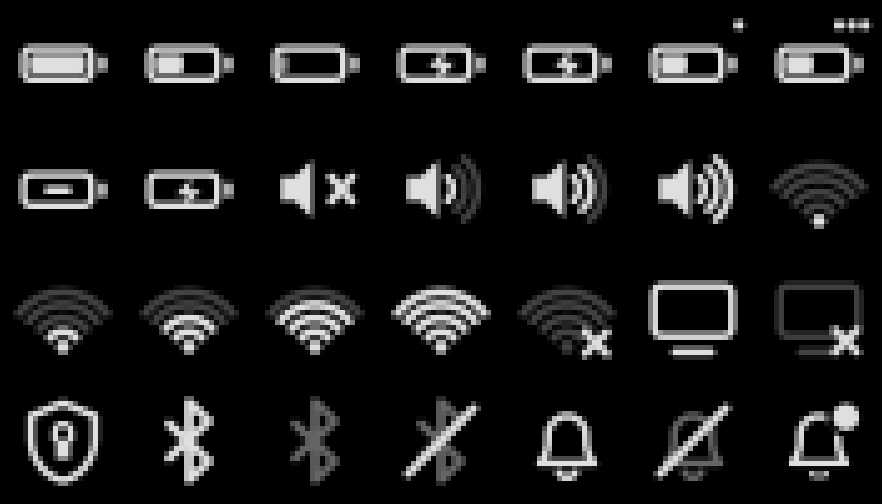

# iris-desktop

**English** · [Türkçe](README.tr.md)

A pitch-black desktop theme for KDE Plasma 6: pure `#000000` ground, mostly
black and white, thin grey borders and a 2px radius everywhere. Colour is used
only where it means something (errors, warnings, success, low battery).


> **A note before you start:** iris-desktop was originally built for my own setup and daily use, and later shared in case it helps someone else. It reflects my own hardware, tools and preferences, so it may not fit every system or workflow. Issues and suggestions are welcome, but please keep that in mind.

The image above is rendered offscreen from the theme's own SVGs, colour scheme
and icons with sample data; the window titles are placeholders.

| Wallpaper | Tray icons |
|---|---|
|  |  |

All design values live in one place: [`docs/TOKENS.md`](docs/TOKENS.md).

## Contents

| Part | Path | What it does |
|---|---|---|
| Colour scheme | `colors/iris.colors` | System-wide palette: pure black window and view backgrounds, grey selection, white focus ring. |
| Plasma style | `desktoptheme/iris/` | Panel, popup, tooltip, button and list SVGs (9-slice, 2px radius). Generated by `scripts/gen_desktoptheme.py`. |
| Window decoration | `decoration/klassyrc` | [Klassy](https://github.com/paulmcauley/klassy) configuration: 2px corners, grey window outline, Fluent-style buttons. |
| Icon layer *(optional)* | `icons/Iris/` | Inherits Papirus and only replaces battery, volume, network, Bluetooth and notification icons with Windows 11 style artwork. Generated by `scripts/gen_icons.py`. |
| Wallpaper | `wallpaper/org.lckt0.iris.topo/` | 2880x1800 topographic contours, almost entirely pure black. Generated by `scripts/gen_wallpaper.py`. |
| Look-and-feel | `look-and-feel/org.lckt0.iris/` | Global theme that ties it together, with a black splash screen. |
| Rofi theme | `rofi/iris.rasi` | Same palette for rofi. |
| KWin script *(optional)* | `kwinscript/iris-popup-anchor/` | Pins panel applet popups to the top-right corner. |

Panel widgets:

| Widget | Id | |
|---|---|---|
| Iris Tasks | `io.github.lckt0.iristasks` | Minimal task manager: icon and title, a sliding active indicator, buttons that shrink as space runs out. |
| Iris Tray *(optional)* | `io.github.lckt0.iristray` | Network, volume, Bluetooth, battery and notification indicators in one compact cluster. |
| Iris Battery Percent | `io.github.lckt0.irisbatterylabel` | Battery percentage as plain text next to the stock battery icon. |
| Iris Power | `io.github.lckt0.irispower` | Battery power draw averaged over the last minute. |
| Iris Fetch | `io.github.lckt0.irisfetch` | fastfetch output drawn natively on the desktop, keys and values in aligned columns. |
| Iris Power & Battery | `io.github.lckt0.irisbattery` | Fork of Plasma's battery widget (powerdevil 6.7.5) with the percentage beside the icon. |
| Iris Digital Clock | `io.github.lckt0.irisclock` | Fork of Plasma's digital clock (plasma-workspace 6.7.5) that always prints AM/PM in Latin script. |
| Panel Colorizer (Iris) | `io.github.lckt0.panelcolorizer` | Fork of [Panel Colorizer](https://github.com/luisbocanegra/plasma-panel-colorizer) 8.0.0 with separate settings for floating and fixed panels. |

The forks install under their own ids, so the stock widgets keep working.
Their changes against upstream are in [`patches/`](patches) (battery and clock)
and marked `Iris fork` in the Panel Colorizer sources.

Motion: the global animation factor is set to 0.5, transitions are 90–150 ms
and only animate opacity, scale and position. Nothing spins or pulses.

## Installation

### Requirements

- KDE Plasma 6 (Wayland or X11)
- [Klassy](https://github.com/paulmcauley/klassy) for the window decoration and application style
- Papirus icon theme (the Iris icon layer inherits from it)
- JetBrains Mono font
- Optional: rofi, fastfetch (for Iris Fetch)

On Arch Linux:

```sh
sudo pacman -S --needed papirus-icon-theme ttf-jetbrains-mono rofi fastfetch
yay -S klassy          # from the AUR, or use any AUR helper
```

There is no Arch package for the theme itself; use the install script.

### Install script

```sh
git clone https://github.com/lckt0/iris-desktop.git
cd iris-desktop
bash install.sh
```

Options:

```sh
bash install.sh --no-apply   # only copy the files, change no settings
bash install.sh --icons      # also select the Iris icon layer
```

A full install copies these files:

| Source | Destination |
|---|---|
| `colors/iris.colors` | `~/.local/share/color-schemes/Iris.colors` |
| `desktoptheme/iris/` | `~/.local/share/plasma/desktoptheme/iris/` |
| `icons/Iris/` | `~/.local/share/icons/Iris/` |
| `wallpaper/org.lckt0.iris.topo/` | `~/.local/share/wallpapers/org.lckt0.iris.topo/` |
| `look-and-feel/org.lckt0.iris/` | `~/.local/share/plasma/look-and-feel/org.lckt0.iris/` |
| `applets/io.github.lckt0.*` | `~/.local/share/plasma/plasmoids/` |
| `decoration/klassyrc` | `~/.config/klassy/klassyrc` (replaces an existing file) |
| `rofi/iris.rasi` | `~/.config/rofi/themes/iris.rasi` |

and, unless `--no-apply` is given, then:

- applies the Iris colour scheme, Plasma style and wallpaper;
- sets Klassy as window decoration and application style, the animation
  factor to 0.5, and enables the blur, contrast, fade and scale effects
  (wobbly windows and magic lamp off) in `kwinrc`;
- removes Breeze colour scheme overrides from `dolphinrc`, `kdenliverc`,
  `konsolerc`, `katerc` and `okularrc`;
- enables GTK animations and selects the rofi theme if `~/.config/rofi/config.rasi` exists;
- restarts plasmashell and puts Iris Battery Percent next to the stock
  battery widget in every panel that has one.

Window decoration changes take effect at the next login.

### Manual installation

Copy the files from the table above to their destinations, then select:

- **System Settings → Colors & Themes → Global Theme → Iris**, or individually
  **Colors → Iris**, **Plasma Style → Iris**, **Window Decorations → Klassy**,
  **Application Style → Klassy** and optionally **Icons → Iris**;
- the wallpaper: right-click the desktop → **Configure Desktop and Wallpaper** → **Iris Topo**.

### Widgets and the KWin script

Add the widgets with right-click on a panel → **Add or Manage Widgets** and
search for "Iris" (or "Panel Colorizer (Iris)").

The KWin script is not installed by `install.sh`:

```sh
kpackagetool6 --type KWin/Script --install kwinscript/iris-popup-anchor
```

Then enable **Iris Popup Anchor** in **System Settings → Window Management → KWin Scripts**.

## Uninstallation

1. Switch back to the default theme:

   ```sh
   plasma-apply-lookandfeel -a org.kde.breezedark.desktop
   ```

   This restores the Breeze Dark colours, Plasma style, icons, window
   decoration and application style. Alternatively pick **Breeze Dark** (or
   **Breeze**) in **System Settings → Colors & Themes → Global Theme**, and
   reset the animation speed under **General Behavior** if you like.

2. Remove the Iris widgets from your panels (right-click → **Remove**) and
   disable **Iris Popup Anchor** if you enabled it.

3. Delete the installed files:

   ```sh
   rm -f  ~/.local/share/color-schemes/Iris.colors
   rm -rf ~/.local/share/plasma/desktoptheme/iris
   rm -rf ~/.local/share/icons/Iris
   rm -rf ~/.local/share/wallpapers/org.lckt0.iris.topo
   rm -rf ~/.local/share/plasma/look-and-feel/org.lckt0.iris
   rm -rf ~/.local/share/plasma/plasmoids/io.github.lckt0.{iristasks,iristray,irisbatterylabel,irispower,irisfetch,irisbattery,irisclock,panelcolorizer}
   rm -f  ~/.config/rofi/themes/iris.rasi
   kpackagetool6 --type KWin/Script --remove iris-popup-anchor   # only if installed
   ```

4. Optional:
   - `~/.config/klassy/klassyrc` was replaced by the Iris configuration; delete
     it to get Klassy's defaults, or uninstall Klassy.
   - remove the `@theme "themes/iris"` line from `~/.config/rofi/config.rasi`.
   - the KWin effect settings written by the installer stay in `~/.config/kwinrc`;
     change them in **System Settings → Window Management → Desktop Effects**.

## Known limitations

- **Klassy keys are group-sensitive.** Keys written to the wrong group in
  `klassyrc` are silently ignored; the valid groups are listed in
  `/usr/share/config.kcfg/klassy-decoration.kcfg` and
  `/usr/share/config.kcfg/klassy.kcfg`.
- **The Klassy window outline needs a new login.** `kwin reconfigure` does not
  apply it to new windows.
- **Application tray icons stay in Plasma's own system tray.** Iris Tray only
  draws its own indicators; hosting StatusNotifierItems requires a containment.
- **The system tray popup cannot be themed into an icon-only grid.** Since
  Plasma 6.7 its QML is compiled into the plugin.
- The battery and clock forks are based on Plasma 6.7.5 and have been used on
  6.8, but may need rebasing on later releases.

## Regenerating assets

All SVGs, icons and the wallpaper are generated; nothing is hand-edited:

```sh
python3 scripts/gen_desktoptheme.py desktoptheme/iris
python3 scripts/gen_icons.py icons/Iris
python3 scripts/gen_wallpaper.py   # deterministic, default seed 20260914
```

`gen_wallpaper.py` needs NumPy and Pillow.

## License

GPL-3.0-or-later, see [LICENSE](LICENSE). The forked widgets keep their
original licenses and copyright headers: Panel Colorizer is GPL-3.0, the
battery and clock widgets from KDE are GPL-2.0-or-later.
